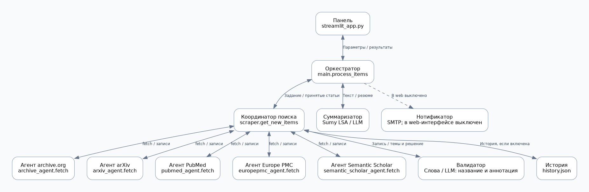

# Трекер научных публикаций

Streamlit-приложение для сбора публикаций из нескольких источников, проверки соответствия заданным темам и создания кратких резюме.

[Открыть приложение](https://ТВОЙ-АДРЕС.streamlit.app)

## Возможности

- Поиск по нескольким темам и выбранному диапазону дат.
- Выбор источников и лимита записей для каждого источника.
- Проверка релевантности по словам или через LLM.
- Резюме через Sumy LSA или подключённую языковую модель.
- Карточки и таблица результатов с совпавшими темами.
- Фильтр и сортировка результатов по темам.
- Просмотр аннотации и технического идентификатора в подробностях.
- История обработанных записей.

## Источники

| Источник | Код | Содержимое |
| --- | --- | --- |
| Internet Archive | `archive` | Материалы цифрового архива |
| arXiv | `arxiv` | Научные препринты |
| PubMed | `pubmed` | Биомедицинские публикации и аннотации |
| Europe PMC | `europepmc` | Биомедицинская литература, включая препринты |
| Semantic Scholar | `semantic_scholar` | Научные публикации разных областей |

## Работа с приложением

1. В боковой панели указать темы, по одной на строку.
2. Выбрать источники, период и лимит записей.
3. Выбрать способ проверки релевантности и параметры резюме.
4. Нажать «Запустить поиск сейчас».
5. Просмотреть карточки или таблицу; при необходимости применить фильтр по темам.

Лимит применяется к каждому источнику суммарно по всем темам. Например, два источника с лимитом 20 возвращают до 40 записей до фильтрации. Отдельная квота на каждую тему не выделяется.

## Архитектура

| Компонент | Модуль | Назначение |
| --- | --- | --- |
| Web-интерфейс | `streamlit_app.py` | Параметры сеанса и результаты |
| Оркестратор | `main.py` | Управление циклом обработки |
| Координатор поиска | `scraper.py` | Вызов источников, проверка истории и передача валидатору |
| Агенты источников | `*_agent.py` | Получение записей через API и преобразование в общий формат |
| Валидатор | `validator.py` | Определение совпавших тем |
| Суммаризатор | `summarizer.py` | Создание резюме |
| Нотификатор | `notifier.py` | SMTP-отправка при отдельном включении |
| Общие функции | `utils.py` | Конфигурация, даты, история и журнал |

Источники опрашиваются последовательно. Принятые валидатором записи передаются суммаризатору и возвращаются в интерфейс. Для резюме используется аннотация; если её длина меньше 200 символов, приложение пытается извлечь текст web-страницы. Объём передаваемого текста ограничивается настройкой интерфейса.

Архитектура основана на разделении ролей между специализированными компонентами. Последовательность действий задаётся Python-кодом; LLM не выбирает инструменты самостоятельно.

## Проверка релевантности

### По словам

Тема разбивается на слова по пробелам и дефисам. Запись принимается, если в названии и аннотации найдены все слова хотя бы одной темы. Порядок слов не учитывается. Короткие токены и аббревиатуры ищутся как целые слова; для остальных допускается совпадение по префиксу. Для Internet Archive при отсутствии совпадений дополнительно проверяется текст страницы.

### Через LLM

Модель оценивает, является ли тема предметом, методом или результатом исследования, по названию и аннотации. Возвращаются совпавшие темы и краткое объяснение. При отсутствии аннотации запись отклоняется. При ошибке API или некорректном ответе модели цикл завершается с сообщением об ошибке.

Для этого режима требуется доступный сервер LLM. Sumy выполняет только суммаризацию и не проверяет смысловое соответствие. Поиск кандидатов в самих источниках остаётся поиском по словам.

## Запуск

Требования: Python 3.12, доступ к интернету и зависимости из `requirements.txt`.

Инструкции по установке, настройке модели и развёртыванию приведены в [QUICKSTART.md](QUICKSTART.md).

Все модули приложения, `config.yaml` и `requirements.txt` находятся в корне репозитория. Схема размещена в `diagr/`.

## Конфигурация и ключи

`config.yaml` содержит темы, источники и публичные настройки по умолчанию. Изменения в web-интерфейсе действуют в пределах текущего сеанса. Сохранение общей конфигурации через интерфейс отключено.

Ключ LLM задаётся через переменную окружения, имя которой указано в `api_key_env`, или через поле «Ключ для этого сеанса». Значение из этого поля не записывается в YAML. Необязательный ключ Semantic Scholar читается из `SEMANTIC_SCHOLAR_API_KEY`.

Реальные ключи и пароли не хранятся в репозитории. Файлы `.env` и `.streamlit/secrets.toml`, окружение `.venv/`, журнал `main.log` и история `history.json` исключаются из Git.

## История и уведомления

`history.json` хранит идентификаторы принятых записей. Пропуск истории и её сохранение включаются отдельно. История обновляется до создания резюме, поэтому её запись не гарантирует успешную суммаризацию.

В публичном развёртывании файловая история общая для пользователей и может быть потеряна при перезапуске сервера. Она не предназначена для долговременного хранения.

Почтовая отправка в web-интерфейсе отключена. Планировщик запускается отдельной командой `python main.py`; запуск Streamlit не включает его автоматически. SMTP-модуль требует отдельной настройки безопасного получения пароля перед использованием почты.

## Ограничения

- Одна статья может присутствовать в нескольких источниках; объединение по DOI/PMID пока не реализовано.
- Наличие записи в базе не гарантирует прохождение научного рецензирования.
- Даты и полнота метаданных зависят от источника.
- API могут ограничивать частоту запросов.
- Собственный векторный поиск и сортировка по цитированиям не реализованы.
- Проверка LLM опирается на аннотацию и может ошибаться; полный текст не анализируется гарантированно.
- Резюме не заменяет чтение оригинальной публикации. Приложение не выдаёт медицинские рекомендации.

## Основа проекта

Использован учебный каркас [EdwFa/MAS — Лекция 3](https://github.com/EdwFa/MAS/tree/main/Лекция_3). Доработки включают дополнительные источники, LLM-проверку релевантности, отображение и фильтрацию тем, обновлённую схему и web-конфигурацию.
